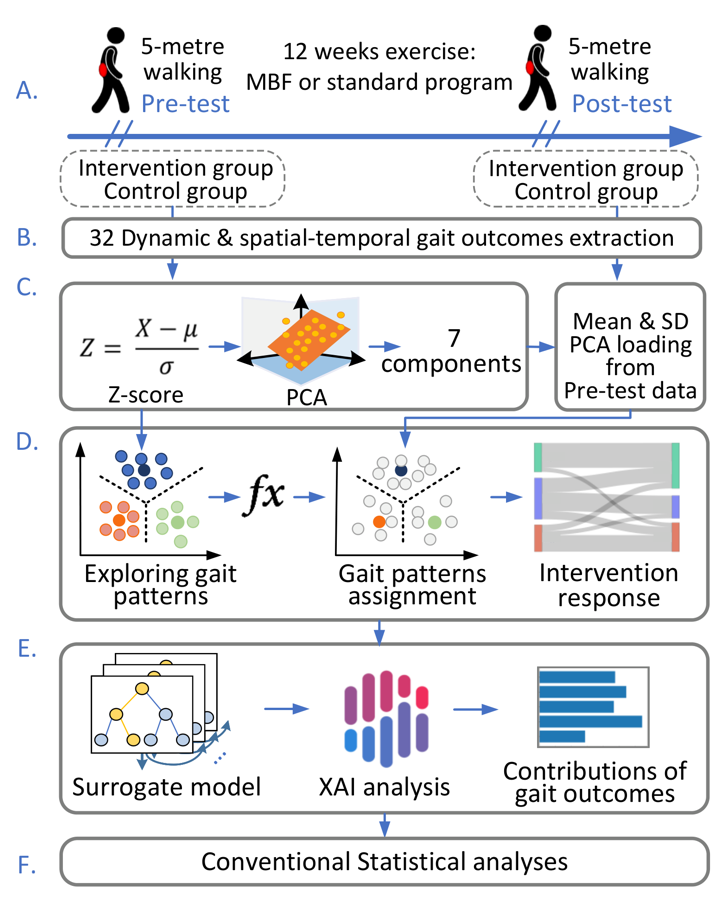

# Wearable Sensor-Based Explainable Machine Learning for Characterizing Gait Pattern Responses to a Multicomponent Physical Activity Intervention in Long-Term Care: Secondary Analysis of a Cluster Randomized Controlled Trial

This repository contains the analysis code for the accompanying study of gait patterns and responses to the Mobility-Fit intervention in long-term care. The analysis uses precomputed IMU gait outcomes, PCA, k-means clustering, XGBoost, and SHAP.

## Workflow

<p align="center">
  
</p>

Figure 1 from the manuscript. Raw IMU processing and gait outcome extraction are not included in this repository.

## Data availability

Study data are available from the corresponding author upon reasonable request.

## Usage

Use Python 3.11. After obtaining the data, place the supplied input files, including `analysis_settings.json`, in `data/`, then run:

```bash
python -m pip install -r requirements.txt
python main.py
```

Outputs are saved to `results/`.

## Citation

If you use this code, please cite the accompanying manuscript:

```bibtex
@unpublished{zheng_wearable_gait_patterns,
  title = {Wearable Sensor-Based Explainable Machine Learning for Characterizing Gait Pattern Responses to a Multicomponent Physical Activity Intervention in Long-Term Care: Secondary Analysis of a Cluster Randomized Controlled Trial},
  author = {Zheng, Xiaoping and Zeng, Ziwei and Ho, Cheuk Yin and Zhou, Junhong and Yang, Yijian},
  note = {Manuscript}
}
```
